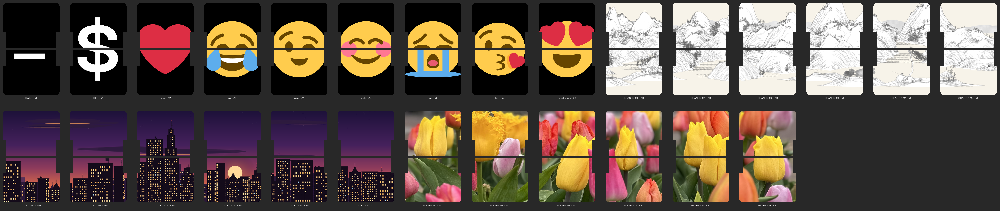

# splitflap-flap-printer — UV Print Layout Generator

Generates print-ready images for UV printing **custom flaps** for
[scottbez1/splitflap](https://github.com/scottbez1/splitflap) displays on a
**eufyMake E1** flatbed UV printer, using a laser-cut jig that holds a row of
blank flaps in a known position.  Feed it a JSON job describing which flap
slots get which artwork — single images, text glyphs in the splitflap fonts,
emoji, procedurally generated art, or one photo stretched across several
modules — and it produces the front and back sheet images (plus a preview
contact sheet) with every pixel where the printer needs it.



Highlights:

- **Front/back pairing done right** — each physical flap carries the bottom
  of one character and the top of the next; the tool slices, pairs and
  mirrors for whichever way you flip the jig (`left-right` or `front-back`).
- **Multi-module panoramas** — one image across N adjacent modules, with
  per-module segments and gap-aware fitting.
- **Flap types**: `single` image (PNG/JPEG/HEIC/SVG), `glyph` (pre-rendered
  Epilogue / Roboto characters), `emoji` (Twemoji), `generated`
  (`city-skyline` built in; `shan-shui-inf` landscapes via Node.js),
  `multi-module`, `blank`.
- **Both eufyMake E1 beds**: Mini Flatbed (6 flaps per pass) and Standard
  Flatbed (30 flaps per sheet, 5 stacked inserts).
- **Ink-save mask, bleed, registration marks, calibration offset, sticky-mat
  prep print** — the fiddly bits of flatbed printing on small parts.
- **OpenSCAD jig** (`cad/`) generated from the same job parameters, so the
  laser-cut insert and the print image can never disagree.

The tool itself has no dependency on the splitflap repository; it only
assumes the standard splitflap flap geometry (54 × 43 mm, overridable).

## Quick Start

Requirements: Python 3.10+.  Optional: [OpenSCAD](https://openscad.org) to
export the jig for laser cutting, [Node.js](https://nodejs.org) for the
`shan-shui-inf` generator.

```powershell
git clone https://github.com/RoboDad/splitflap-flap-printer.git
cd splitflap-flap-printer

# Create and activate a virtual environment (activate again in each new terminal)
python -m venv .venv
.venv\Scripts\Activate.ps1          # PowerShell;  .venv\Scripts\activate.bat for cmd;  source .venv/bin/activate on macOS/Linux

pip install -r requirements.txt

# Validate a job and print the geometry summary — writes nothing but cad/flap_printer_params.scad
python -m flap_printer examples/example_basic_job.json --dry-run

# Render it: batch_NN_front/back.png + preview.png land in examples/example_basic_output/
python -m flap_printer examples/example_basic_job.json
```

All commands are run from the repo root so that Python finds the
`flap_printer` package.  (Alternatively `pip install -e .` installs a
`flap_printer` console command that works from any directory.)

Two example jobs ship in `examples/`:

- `example_basic_job.json` — glyphs, emoji, the built-in `city-skyline`
  generator and a 6-module photo.  No external runtime needed.
- `example_job.json` — the full showcase: the same plus a `shan-shui-inf`
  landscape (needs Node.js), both jig definitions (`--jig standard`), and
  an `archived_flaps` parking-lot entry.

Then open `preview.png` in the output directory to see the flaps as they
will appear on the display, and import the `batch_*_front.png` /
`batch_*_back.png` images into eufyMake Studio (Zero Point alignment mode,
image anchored at the lower-right of the mat — see [Output](#output)).

## Workflow overview

1. **Cut the jig** once: run any job with `--dry-run`, open
   `cad/flap_printer_jigs.scad` in OpenSCAD, export the insert and outer
   jig SVGs, laser-cut them (see the file header for materials/thickness).
2. (Optional, once per mat) print the [sticky mask](#sticky-mask-mat-preparation)
   so the mat does not grip the flaps.
3. **Write a job file** (copy an example): display geometry, jig, output
   options, and one `custom_flaps` entry per flap slot.
4. **Render** (`python -m flap_printer my_job.json`), check `preview.png`.
5. **Print the front sheet**, flip the insert as the job's `flip_mode`
   says, **print the back sheet**.  Repeat per batch.

## Usage

```
python -m flap_printer JOB_FILE [options]

positional arguments:
  job_file              Path to JSON job config file

options:
  --dpi INT             Override output DPI (default: from config or 360)
  --output-dir PATH     Override output directory
  --modules M [M ...]   Process specific modules only
  --no-labels           Disable EP labels
  --no-mask             Disable ink-saving mask
  --registration-marks / --no-registration-marks
                        Override the config's corner registration marks
  --flip-mode MODE      left-right | front-back (overrides config)
  --jig NAME            Select a jig from the job file's "jigs" map (overrides active_jig)
  --print-size W H      Override output size in mm
  --sticky-mask         Generate the one-time mat-preparation sticky mask instead of
                        batch output (see Sticky Mask section)
  --dry-run             Validate config, print summary
  --verbose, -v         Verbose logging
  --cad-dir PATH        Where to write flap_printer_params.scad (default: <repo>/cad)
  --scad-dims PATH      Advanced: OpenSCAD file echoing FLAP_PRINTER:key=value flap
                        dimensions (see Dimensions)
  --openscad PATH       Path to OpenSCAD executable for --scad-dims (auto-detected)
```

## Command Snippets

Copy-paste-ready PowerShell.  Activate the venv first (`.venv\Scripts\Activate.ps1`);
everything below assumes the repo root as the working directory.  For a
no-terminal run, double-click `scripts\gen_custom_flaps.bat` (it activates
the venv and runs `gen_custom_flaps.ps1`, a comment-toggle runner script).

```powershell
# Validate the job config and print a geometry summary — no images written
# (cad/flap_printer_params.scad is still regenerated for OpenSCAD)
python -m flap_printer examples/example_job.json --dry-run

# Full render on the minibed (active_jig) — batches + preview into
# examples/example_output/
python -m flap_printer examples/example_job.json

# Same job packed onto standard-flatbed sheets (30 flaps per print run,
# sheet_NN images + sheets_manifest.txt)
python -m flap_printer examples/example_job.json --jig standard

# Re-render only specific modules' sequences (e.g. after fixing one flap)
python -m flap_printer examples/example_job.json --modules 0 3

# Override the flip mode for one run (job default is front-back)
python -m flap_printer examples/example_job.json --flip-mode left-right

# Alignment-debug print: corner registration marks on, ink-save mask off
python -m flap_printer examples/example_job.json --registration-marks --no-mask

# One-time mat preparation: sticky mask for the minibed / standard bed
# (see the Sticky Mask section for the print procedure)
python -m flap_printer examples/example_job.json --sticky-mask
python -m flap_printer examples/example_job.json --sticky-mask --jig standard

# Regenerate cad/flap_printer_params.scad for a specific jig before
# opening flap_printer_jigs.scad in OpenSCAD (e.g. to laser-cut the
# standard outer jig) — dry-run still writes the params file
python -m flap_printer examples/example_job.json --jig standard --dry-run

# Render to a throwaway directory
python -m flap_printer examples/example_job.json --output-dir "$env:TEMP\flap_test"

# Regression fixture: multi-module segments with a deliberate coverage
# gap (expects a "no coverage" warning + blank flap)
python -m flap_printer examples/test_multimodule_job.json

# Procedural generation demo: shan-shui landscape across modules 0-5
# (seed 42; requires Node.js — see the Generated Images section)
python -m flap_printer examples/test_generated_job.json

# Asset generation (see scripts/gen_glyphs.bat / gen_emojis.bat for the batch form)
python scripts/download_emoji.py "❤️"
python scripts/generate_epilogue_flap_svgs.py --font Epilogue   # needs OpenSCAD + splitflap checkout
```

---

## Job Config (JSON)

See `example_job.json` for a complete example. The config has five sections:

> **Archiving entries:** JSON has no comments, so the top-level
> `"archived_flaps"` section serves as a parking lot — cut-and-paste
> `custom_flaps` entries into it and they are completely ignored (never
> parsed or validated, so stale paths and duplicate slots in the archive
> are fine).  The loader logs how many entries it skipped.

> **Your own images:** put personal photos and artwork in `assets/local/`
> (gitignored) and reference them from your job files, e.g.
> `"source": "../assets/local/my_photo.png"` — or keep your job files and
> images together in a separate private repo and point `flap_printer` at
> them.  Nothing under `assets/local/` ever reaches GitHub.

### `display` — Display geometry

| Key | Type | Default | Description |
|-----|------|---------|-------------|
| `num_modules` | int | `48` | Total modules in the display |
| `module_pitch_mm` | float | `64.0` | Center-to-center distance between modules (mm) |
| `inter_module_gap_mm` | float | `10.0` | Gap between adjacent module frames (mm) |

### `jig` / `jigs` — Print jig settings

All jig coordinates are in **printer orientation** — exactly as the jig sits
on the eufyMake E1 flatbed, viewed from above.  The mat's long axis runs
along X (left/right), and the mat zero-point corner (the one with the
diagonal corner cut) is at the bottom-right.  The OpenSCAD model
(`cad/flap_printer_jigs.scad`), the output print images, and the physical
flatbed all share this one frame.  Flap pockets sit rotated 90° in the jig —
spool/notch edge facing right, toward the zero point — in rows along X, so a
pocket's X extent is `flap_height` and its Y extent is `flap_width`.

A job file may define a single `"jig"` object, **or** a `"jigs"` map of named
definitions plus `"active_jig"` selecting one (override per run with
`--jig NAME`):

```json
"active_jig": "minibed",
"jigs": {
  "minibed":  { "type": "minibed",  "printable_size_y_mm": 88,  ... },
  "standard": { "type": "standard", "printable_size_y_mm": 418,
                "insert_rows": 5, "insert_pitch_y_mm": 81, ... }
}
```

Both beds use the **same laser-cut insert jig**; the standard flatbed simply
stacks 5 of them in rows along Y (see [Standard Flatbed
Sheets](#standard-flatbed-sheets)).

| Key | Type | Default | Description |
|-----|------|---------|-------------|
| `type` | string | `"minibed"` | Jig name shown in logs/output (`"minibed"` or `"standard"` by convention — the geometry comes entirely from the keys below) |
| `flip_mode` | string | `"front-back"` | How the jig is physically flipped to load the back: `"front-back"` (pancake flip — rotate about the long X axis) or `"left-right"` (side flip — rotate about the short Y axis) |
| `num_flaps_x` | int | `6` | Number of flap pocket columns in the jig insert (along the long X axis) |
| `num_flaps_y` | int | `1` | Number of flap pocket rows in the jig insert |
| `gap_x_mm` | float | `6.0` | Horizontal gap between flap pockets (mm) |
| `gap_y_mm` | float | `6.0` | Vertical gap between flap pockets (mm) |
| `margin_x_mm` | float | `6.0` | Horizontal margin around the pocket grid inside the insert (mm) |
| `margin_y_mm` | float | `6.0` | Vertical margin around the pocket grid inside the insert (mm) |
| `printable_size_x_mm` | float | `333.0` | Width of the printer's printable area along the long X axis (mm). Used as the default canvas width and to anchor insert position. |
| `printable_size_y_mm` | float | `88.0` | Depth of the printer's printable area along the short Y axis (mm). Used as the default canvas height. |
| `printable_origin_x_mm` | float | `4.0` | X position of printable area's lower-left corner in mat absolute coordinates (mm) |
| `printable_origin_y_mm` | float | `5.0` | Y position of printable area's lower-left corner in mat absolute coordinates (mm) |
| `insert_origin_x_mm` | float | `20.5` | X position of insert's lower-left corner in mat absolute coordinates (mm). With multiple insert rows, this is the first (top) insert. |
| `insert_origin_y_mm` | float | `16.0` | Y position of insert's lower-left corner in mat absolute coordinates (mm) |
| `insert_rows` | int | `1` | Number of identical insert jigs stacked along Y (5 on the standard flatbed). Each insert is flipped individually for the back pass. |
| `insert_pitch_y_mm` | float | — | Y distance between successive insert origins (mm). Required when `insert_rows > 1`. |
| `calibration_offset_mm` | `[dx, dy]` | — | Per-jig override of `output.calibration_offset_mm` — zero-point error is a property of the bed, so calibrate each jig here. |
| `canvas_size_mm` | `[w, h]` | — | Per-jig override of `output.canvas_size_mm` (Camera-mode canvas differs per bed). |
| `laser_kerf_mm` | float | `0.04` | Inward offset applied to each flap pocket when cutting the insert (tightens fit) |
| `insert_kerf_mm` | float | `0.04` | Outward offset applied to the insert outline when cutting the outer jig (compensates laser kerf) |
| `mat_size_x_mm` | float | `370.0` | eufyMake minibed mat outer length along X (mm) — hardware constant, rarely changed |
| `mat_size_y_mm` | float | `97.0` | eufyMake minibed mat outer depth along Y (mm) — hardware constant, rarely changed |
| `mat_corner_radius_mm` | float | `7.5` | Mat outer corner radius (mm) |
| `mat_corner_cut_mm` | float | `22.0` | Mat diagonal corner cut length (mm) at the mat origin corner |
| `reg_mark_size_mm` | float | `6.0` | L-shaped registration mark arm length (mm) — written to `flap_printer_params.scad` for use by the laser-cut outer jig |
| `reg_mark_stroke_mm` | float | `1.0` | Registration mark stroke width (mm) |

> **Note:** All jig and mat parameters are written to `cad/flap_printer_params.scad`
> on every render (override the directory with `--cad-dir`). Open
> `cad/flap_printer_jigs.scad` in OpenSCAD to generate the laser-cut SVG files
> for the insert and outer jig.

### `output` — Output file settings

| Key | Type | Default | Description |
|-----|------|---------|-------------|
| `dpi` | int | `360` | Output resolution in dots per inch |
| `format` | string | `"png"` | Output image format |
| `bleed_mm` | float | `1.0` | Bleed expansion and ink-save mask margin beyond the flap pocket edge (mm). See [Bleed Margin](#bleed-margin). |
| `ink_save_mask` | bool | `true` | Zero alpha outside flap pockets to save ink |
| `labels` | bool | `true` | Render EP slot labels in the gap areas |
| `label_font_size_pt` | int | `6` | Label font size in points |
| `output_dir` | string | `"output"` | Output directory (relative paths are resolved against the job file's directory, not CWD) |
| `canvas_size_mm` | `[w, h]` | _unset_ | Optional output image canvas size in mm. When set, the rendered image is sized to these dimensions without changing physical jig geometry. The insert stays anchored to the image's left and bottom edges (extra canvas area is added at the top and right), so all flap positions keep their calibrated placement. Omit to use the jig section's `printable_size_x/y_mm` (default 333 × 88 mm, matches eufyMake **Zero Point** alignment mode). See note below on eufyMake alignment modes. |
| `registration_marks` | bool | `false` | Draw 5 mm L-shaped registration marks in the 4 corners of the output image to aid alignment debugging. The bottom-right mark is rendered green to indicate the eufyMake Zero-Point origin; the other three are white. |
| `registration_mark_line_width_mm` | float | `1.0` | Line width (mm) of the registration mark arms. Marks thinner than ~0.5 mm tend not to print reliably on the eufyMake. |
| `calibration_offset_mm` | `[dx, dy]` | `[0, 0]` | Global mat-calibration offset (mm) applied to every drawn element in the final output image (flap art, ink-save mask, labels, and registration marks all shift together). Use this to compensate for a systematic offset between the printer's zero-point and the physical jig (e.g. eufyMake Zero-Point calibration being off by a couple of mm). Positive `dx` shifts content toward +X (along the long axis, away from the zero point); positive `dy` shifts toward +Y (downward in the image). Content shifted past the image edge is clipped. |
| `sticky_mask_inset_mm` | float | `2.5` | Inset (mm) for the `--sticky-mask` coat: the flap footprint pulled inward on all edges, leaving a sticky perimeter ring this wide. `0` = coat the exact flap footprint (all tack removed). See [Sticky Mask](#sticky-mask-mat-preparation). |
| `sticky_mask_color` | `[R, G, B]` | `[0, 255, 255]` | Fill color of the sticky-mask coat. Default cyan — print it as a color-only layer (no white underlayer) for the thinnest possible ink film. |

> **eufyMake alignment modes & canvas size.** The eufyMake Studio app has two
> alignment modes with *different* working canvas sizes:
>
> | Mode | Canvas size | Origin reference |
> |------|-------------|------------------|
> | **Camera** | 335 × 90 mm | Camera-detected mat position |
> | **Zero Point** | 333 × 88 mm | Mat zero-point (lower-right corner of imported image) |
>
> The jig `printable_size_*` constants (333 × 88) match **Zero Point**
> mode exactly, so the default (no `canvas_size_mm` override) is correct when
> using the alignment jig in Zero Point mode. Importing a 335 × 90 image into
> Zero Point mode will appear ≈2 mm offset because the origin reference doesn't
> match the image canvas. If you intend to use Camera mode, set
> `canvas_size_mm: [335, 90]`.

### `preview` — Module preview contact sheet

Optional section. When `enabled` is `true`, a contact-sheet PNG is written
to the same output directory as the print images (e.g. `output/preview.png`).
Each cell shows one flap slot rendered as it would appear on the physical
display: two flap halves separated by the real gap, with the physical flap
shape drawn in `flap_color` and the artwork alpha-composited on top.

| Key | Type | Default | Description |
|-----|------|---------|-------------|
| `enabled` | bool | `false` | Generate the preview image |
| `columns` | int | `12` | Number of cells per row in the grid |
| `cell_padding_mm` | float | `3.0` | Gap between cells and around the grid border (mm) |
| `flap_color` | `[R, G, B]` | `[20, 20, 20]` | Physical flap stock colour |
| `background_color` | `[R, G, B]` | `[245, 245, 245]` | Overall canvas background colour |
| `label_color` | `[R, G, B]` | `[60, 60, 60]` | Label text colour |
| `label_font_size_pt` | int | `7` | Label font size in points |
| `dpi` | int | `96` | Preview image resolution (screen DPI, independent of print DPI) |
| `filename` | string | `"preview.png"` | Output filename (written into the root output directory) |

The label below each cell shows both the `label` field and the `slot` index
(e.g. `DASH · #0`). Multi-module flaps show one cell per module with the
module index appended (e.g. `EP47 M5 · #2`).

Example minimal config to add to any job:

```json
"preview": {
  "enabled": true,
  "columns": 12
}
```

### `global_transforms` — Default image transforms

Applied to all input images unless overridden per-flap.

| Key | Type | Default | Description |
|-----|------|---------|-------------|
| `scale` | [float, float] | `[1.0, 1.0]` | Scale multiplier `[sx, sy]` applied after crop |
| `crop_percent` | [L, T, R, B] | `null` | Percentage to trim from each edge: `[left%, top%, right%, bottom%]` |
| `fit_mode` | string | `"fit"` | How images are fit to the target flap area (see [Fit Modes](#fit-modes)) |
| `notch_mode` | string or `[left, right]` | `"none"` | Notch-clearance modifier (see [Notch Modes](#notch-modes)) |

### `custom_flaps` — Flap definitions

An array of objects, one per custom flap. Required fields: `slot`, `source`.

| Key | Type | Default | Description |
|-----|------|---------|-------------|
| `slot` | int | *required* | 0-based index in the custom flap sequence. Must be **unique** — one entry per physical flap position (duplicate slots are a config error). |
| `label` | string | `"EP{slot+42}"` | Display label (e.g. `"EP42"`) |
| `source` | string | *required* (except `blank`, `glyph`, `emoji`, `epilogue`, and `multi-module` with `segments`) | Image path (PNG/JPEG/SVG), relative to the JSON config file's directory |
| `type` | string | `"single"` | `"single"`, `"multi-module"`, `"blank"`, `"glyph"`, `"emoji"`, `"epilogue"`, or `"generated"` (see [Custom Flap Types](#custom-flap-types)) |
| `module_range` | [int, int] | `null` | `multi-module` only: inclusive range `[start, end]` covered by the entry-level `source` (the flat, single-image form). Use `segments` instead to stitch several images. |
| `segments` | list | `null` | `multi-module` only: list of `{module_range, source, ...}` objects stitching the flap from several images (see [Multi-Module Segments](#multi-module-segments)). Mutually exclusive with the flat `source` + `module_range` form. |
| `generator` | string | — | `generated` only (required): which procedural generator to run, e.g. `"shan-shui-inf"` (see [Generated Images](#generated-images)) |
| `seed` | string/int | random | `generated` only: seed for reproducible output. Omitted → a random seed is used and logged with a warning so you can pin it. |
| `params` | object | `{}` | `generated` only: generator-specific options passed through (e.g. `{"background": "#f7f3e9"}` for shan-shui-inf) |
| `index` | int | `null` | Required for `epilogue` if `char` is not given; 0-based index into the standard 52-flap character set |
| `char` | string | `null` | Required for `epilogue` if `index` is not given; single character from the standard 52-flap set |
| `scale` | [float, float] | `null` | Per-image scale override `[sx, sy]`; `null` = use global |
| `crop` | [L, T, R, B] | `null` | Per-image crop override `[left%, top%, right%, bottom%]`; `null` = use global |
| `fit_mode` | string | `null` | Per-image fit mode override; `null` = use global default |
| `notch_mode` | string or `[left, right]` | `null` | Per-image notch-clearance override; `null` = use global default |
| `offset_mm` | `[dx, dy]` | `null` | Shift image content by `[dx_mm, dy_mm]` within the pocket, applied after all fit/notch transforms and before the ink-save mask. Positive X shifts right, positive Y shifts down. Content pushed past the pocket edge is clipped by the ink-save mask. Useful for fine-tuning the position of an image within its flap without recompositing the source artwork. |
| `bleed` | bool | `true` | When `false`, skips OUTER-edge bleed expansion for this image (the ink-save mask and the always-on gap-edge bleed still apply — see [Bleed Margin](#bleed-margin)). Useful for images with transparent outer borders that don't need the misalignment buffer. |
| `enabled` | bool | `true` | When `false`, output for this flap is fully transparent; the slot position is preserved in the layout. Useful for temporarily disabling a slot without removing it from the config. |

---

## Image Offset (`offset_mm`)

The per-flap `offset_mm: [dx_mm, dy_mm]` field shifts the fitted image content
within the pocket after all fit, notch, and bleed transformations have been
applied, but before the ink-save mask clips the result.

```json
{"slot": 3, "type": "emoji", "name": "heart", "offset_mm": [0, -2.5]}
```

**Coordinate system** (matches the print output image):
- **Positive X** → shifts content **right**
- **Negative X** → shifts content **left**
- **Positive Y** → shifts content **down**
- **Negative Y** → shifts content **up**

The offset is applied to the full display image (both halves together) before
the top/bottom split. This means a vertical offset moves the character up or
down relative to the gap line — e.g. `[0, -3]` raises the whole character 3 mm,
so more of the top half's area has content and the bottom half loses content
at its lower edge.

Content pushed outside the `pocket + bleed_mm` boundary is clipped by the
ink-save mask, same as bleed overflow. The preview image shows the offset
applied, so what you see in `preview.png` matches the final printed flap.

**Contrast with `calibration_offset_mm`** (in the `output` section):
that field shifts the *entire output canvas* — flap art, ink-save mask, labels,
and registration marks all move together — to compensate for a systematic
printer-vs-jig registration error. `offset_mm` moves only the artwork for one
specific flap entry, leaving all other flaps and the mask shape unchanged.

**When to use it:** fine-tuning image placement within a pocket when the
source artwork has uneven whitespace, or when an emoji's visual centre of mass
reads as off-centre after fitting. Prefer adjusting source artwork instead when
doing so is straightforward.

---

## Fit Modes

Controls how each input image is mapped to the target flap area
(54 × 88 mm for single-module images). Set globally in `global_transforms.fit_mode`
and/or per-image via `fit_mode` on individual `custom_flaps` entries.

| Mode | Behavior |
|------|----------|
| **`fit`** (default) | Uniform scale to fit *within* target. Transparent letterbox padding, centered. Aspect ratio preserved; no cropping. |
| **`fill`** | Uniform scale to *cover* the entire target. Center-crop any overflow. Aspect ratio preserved; edges may be lost. |
| **`stretch`** | Non-uniform resize to exact target dimensions. May distort if aspect ratio differs from 54:88. |
| **`contain`** | No scaling at all. Image is centered on the target canvas as-is. Useful for pre-sized artwork at the correct DPI. |

**Recommended workflow:** Start with `"fit"` (default) to see how your artwork
maps onto the flaps. Switch to `"fill"` if you prefer edge-to-edge coverage
and don't mind losing some border. Use `"stretch"` only if the image is already
at the correct aspect ratio and you want pixel-exact mapping.

---

## Notch Modes

Flaps have a notch cutout (default depth `3.2 mm`) on each side at the spool
pin location. If an image fills the full `54 mm` width, the edges of the image
will be hidden behind the notch walls. `notch_mode` controls how the image is
adjusted to account for this.

Set globally in `global_transforms.notch_mode` and/or per-image via `notch_mode`
on individual `custom_flaps` entries. The effective safe width is
`flap_width - 2 × notch_depth` (default: 54 - 2×3.2 = **47.6 mm**).

### Symmetric (string) form

A plain string applies the same mode to both sides:

| Mode | Behavior |
|------|-----------|
| **`"none"`** (default) | No adjustment. Image fills the full 54 mm canvas. Use for text/character glyphs that already stay clear of the notch zone. |
| **`"inset"`** | Image is fit into the **safe-width** canvas (47.6 mm), then centered on the full 54 mm canvas with transparent bands at the sides. Best for emoji/icons where you want the full image visible. |
| **`"squeeze"`** | Image is fit to the full 54 mm canvas as normal, then **non-uniformly scaled** to the safe width. Height is unchanged; the image is slightly narrower. Best when you want edge-to-edge coverage and a small aspect-ratio change is acceptable. |

### Per-side (list) form

Pass a two-element list `[left_mode, right_mode]` to control each notch independently.
Each element is one of `"none"`, `"inset"`, or `"squeeze"`.

```json
// Both sides — equivalent to the string form above:
{"notch_mode": "inset"}
{"notch_mode": ["inset", "inset"]}

// Left side only (right notch is unobstructed):
{"notch_mode": ["inset", "none"]}

// Right side only:
{"notch_mode": ["none", "squeeze"]}

// Different depths on each side — squeeze wins for the fitting step:
{"notch_mode": ["inset", "squeeze"]}
```

When sides have different modes, **`"squeeze"` takes precedence** for the
image-fitting step: the image is always fit to full width first and then
scaled to the content area, regardless of which side requested it.

The `left_inset` and `right_inset` gaps are computed independently:

| JSON value | Content width | `paste_x` |
|---|---|---|
| `"inset"` / `["inset","inset"]` | 47.6 mm | 3.2 mm (centered) |
| `["inset", "none"]` | 50.8 mm | 3.2 mm (left gap only) |
| `["none", "inset"]` | 50.8 mm | 0 mm (right gap only) |
| `["squeeze","none"]` | 50.8 mm | 3.2 mm |

**Choosing a mode:** Use `"inset"` for icons and emoji — content is untouched
but the sides will not be visible past the notch. Use `"squeeze"` when the
slight horizontal compression is preferable to visible letterbox bands.
Use the list form when an image only approaches one notch.

---

## Image Pipeline

The full transformation chain from input image to output print file:

1. **Load** — Source image opened as RGBA (any pixel size)
2. **Crop** — Per-image `crop` or fallback to `global_transforms.crop_percent`
3. **Scale** — Per-image `scale` or fallback to `global_transforms.scale`
4. **Fit + Notch** — Image fit to target dimensions using `fit_mode`; then
   `notch_mode` adjusts the result to clear the spool-pin notch cutouts
   - Single: target = `flap_width` × `display_height` (54 × 88 mm)
   - Multi-module: target = full span width × `display_height`
5. **Slice** — Split into top half (43mm) and bottom half (43mm); 2mm gap discarded
6. **Map to flap sides** — Front of flap K = top(K), back of flap K = bottom(K+1)
7. **Batch** — Group into jig-sized batches (6 flaps per batch)
8. **Layout** — Place on printable-area canvas (88 × 330mm) with insert
   offset. Images that have been bleed-expanded in step 4 are pasted offset
   by their bleed amount so the pocket area aligns with its grid position
   and the overflow extends into the bleed zone (see
   [Bleed Margin](#bleed-margin) below).
9. **Flip** — Back-side flaps reordered to their post-jig-flip grid positions
   (individual flap content is **not** mirrored)
10. **Mask** — Ink-save mask zeros alpha outside flap pockets (+ bleed)
11. **Labels** — EP labels rendered in gap margins
12. **Save** — PNG with embedded DPI metadata
13. **Preview** — If `preview.enabled`, a contact-sheet grid is written to the
    root output directory at `preview.dpi` (default 96 DPI, independent of
    print DPI).

### Input Images

Each input represents a **full display character** as a viewer would see it:

```
┌──────────────┐
│  top half    │ ← 43mm (flap_height)
│              │
├──────────────┤ ← 2mm gap (discarded)
│  bottom half │ ← 43mm (flap_height)
│              │
└──────────────┘
     54mm
    (flap_width)
```

Total height = 2 × 43 + 2 = 88mm. Any pixel dimensions are accepted; the
image is fit to the physical target size using the active `fit_mode`.

### Flap Side Mapping

- **Flap K front** = top half of image K
- **Flap K back** = bottom half of image K+1
- **Last flap back** = blank (transparent)

### Custom Flap Types

- **`single`**: One image per flap. Same output for all modules. Source may
  be a raster (PNG/JPEG) or an `.svg` file (see [SVG Inputs](#svg-inputs)).
- **`multi-module`**: Image spans multiple modules (e.g., triptych).
  Either the flat form — `source` + `module_range: [start, end]` (inclusive)
  for a single image — or a `segments` list stitching several images (see
  [Multi-Module Segments](#multi-module-segments)). The tool extracts the
  correct column for each module automatically. Raster or SVG.
- **`blank`**: Fully transparent top/bottom halves. No source required.
- **`glyph`**: Resolves to a pre-rendered per-character SVG from
  `assets/flap_glyphs/<font>/`. Specify the font with `font` (default
  `"Epilogue"`), and the character via either `char` or `index` (0–51).
  No `source` field needed. Example:

  ```json
  {"slot": 0, "type": "glyph", "font": "Epilogue", "char": "H"},
  {"slot": 1, "type": "glyph", "font": "Roboto",   "char": "H"}
  ```

  Assets must exist under `assets/flap_glyphs/<font>/` — run the
  [glyph generator](#glyph-generator-generate_epilogue_flap_svgspy) first
  for any font other than Epilogue (which ships pre-rendered). The SVG
  files can be hand-edited (e.g. to change fill color) after generation.
- **`epilogue`**: Backward-compatible alias for `{"type": "glyph", "font": "Epilogue"}`.
  The `font` field is ignored; Epilogue is always used. Existing job files
  using `"type": "epilogue"` continue to work without changes.

  The bundled Epilogue assets are pre-rendered with a **white** (`#ffffff`)
  fill for dark flap stock. Re-run the generator with `--fill-color` to
  change the color — see
  [Glyph generator](#glyph-generator-generate_epilogue_flap_svgspy).
- **`emoji`**: Resolves to a Twemoji SVG from `assets/emoji/`. Download SVGs
  first with `scripts/download_emoji.py`, then optionally hand-edit the SVG
  (colors, stroke weights) before committing. Specify the emoji with `name`
  (the filename stem) or `char` (auto-resolved to CLDR name at load time).
  Example:

  ```json
  {"slot": 3, "type": "emoji", "name": "waving-hand-medium-skin-tone"},
  {"slot": 4, "type": "emoji", "char": "❤️"}
  ```

  Source: Twemoji (Twitter/X), CC-BY 4.0 — covers Unicode 14.0 / ~3,600 emoji.
  See [Emoji downloader](#emoji-downloader-download_emojipypy).
- **`generated`**: Procedurally generated artwork. Specify the `generator`
  by name and (optionally) a `seed`; the generator runs once at config-load
  time, its output is cached, and the entry lowers to a normal `single` or
  `multi-module` flap (with `module_range`, the image is generated at the
  exact aspect ratio of the module span). See
  [Generated Images](#generated-images).

### Multi-Module Segments

One multi-module flap (one slot) can be stitched from several source images,
each covering its own module range, using a `segments` list:

```json
{"slot": 11, "type": "multi-module", "label": "TRI (53)", "fit_mode": "fit", "segments": [
  {"module_range": [0, 0], "source": "assets/images/FrogAndElf.PNG"},
  {"module_range": [1, 2], "source": "assets/images/WideBunnyTruck.PNG"},
  {"module_range": [3, 5], "source": "assets/images/WideMoth.PNG", "fit_mode": "stretch"}
]}
```

Rules and behavior:

- Each segment requires `module_range: [start, end]` (inclusive) and a
  `source` — or `"blank": true` to render that range transparent.
- Segment ranges within one flap must **not overlap** (config error).
  List order doesn't matter; segments are sorted by range at load time.
- Per-segment `fit_mode`, `scale`, `crop`, `notch_mode`, and `offset_mm`
  override the entry-level values, which in turn override the global
  defaults (entry `"fit"` above; the last segment overrides to `"stretch"`).
- Each segment's image is fit to *its own* span (e.g. `[1, 2]` spans two
  module widths) and then sliced per module, exactly like a flat
  multi-module entry covering that range.
- Modules the job processes that no segment covers render as blanks and
  log a warning; an explicit `"blank": true` segment covers the range
  silently.
- The flat form (`source` + `module_range` on the entry) is simply the
  one-segment case; use one or the other, not both.

See `test_multimodule_job.json` for a small runnable example including a
coverage gap.

### Generated Images

The `generated` flap type runs a procedural art generator and uses its
output as the flap source:

```json
{"slot": 12, "type": "generated", "generator": "shan-shui-inf", "seed": 42,
 "module_range": [0, 5], "fit_mode": "fill", "label": "SHAN:42"}
```

How it works:

- The generator runs at **config-load time** and the entry lowers to an
  ordinary `single` / `multi-module` flap, per the "adding new flap types"
  contract — the render pipeline never knows generators exist.
- With `module_range`, the image is generated at the **exact aspect ratio
  of the module span** (span × pitch − gap : 88 mm display height), so
  `fit_mode: "fill"` maps it edge-to-edge with no cropping surprises.
- Output is **cached** under `generated/<generator>/`, keyed by
  seed + geometry + params: the external tool runs once per unique
  combination, and re-renders are instant.  The cache directory is
  gitignored (it's reproducible from the job config); copy a keeper into
  `assets/local/` if you want it pinned.
- **Seeds**: same seed → byte-identical generator output.  Omit `seed`
  to explore — a random seed is used and logged with a warning showing
  exactly what to paste into the entry to keep it.
- **Generator options must be nested inside `"params"`** — a top-level
  key like `"time_of_day"` on the entry is not a generator option (the
  loader warns about unrecognized keys on `generated` entries and
  ignores them).

Available generators:

- **`city-skyline`** (aliases `skyline`, `city`) — first-party stylized
  city skyline (pure Python, `flap_printer/gen_city_skyline.py`; no
  external runtime).  Three depth layers of varied buildings — slab
  towers, art-deco setbacks, glass towers, NYC walk-ups with fire escapes
  and rooftop water towers, spired landmarks — plus antennas with
  beacons, roof clutter, and occasional rooftop silhouettes (humans,
  cats, dogs).  `params`:
  - `time_of_day` — `"night"` (default: near-black sky with city-glow
    gradient, stars, cratered moon with halo, lit windows, occasional
    UFO), `"dusk"` (sunset gradient, sun setting into a skyline valley,
    streak clouds, early stars), or `"day"` (blue gradient, sun, puffy
    clouds, jet contrails, unlit/reflective windows).
  - `density` — 0..1 skyline fullness (default 0.92; lower = more gaps).
  - `moon` / `ufo` — booleans (night only; `ufo` defaults to a seeded
    ~1-in-3 chance).
  - `height` — world height in SVG units (default 800).
- **`shan-shui-inf`** (aliases `shan-shui-infinite`, `shanshui`) —
  *{Shan, Shui}\** by Lingdong Huang: procedurally generated
  vector-format Chinese landscape painting (MIT, vendored under
  `generators/shan-shui-inf/` with a headless Node driver).
  **Requires Node.js on PATH.**  The infinite-scroll generator is
  windowed at the panel's aspect; the seed feeds the same `?seed=`
  mechanism as [the website](https://lingdong-.github.io/shan-shui-inf/),
  so you can preview seeds in a browser first (the rendered window will
  differ slightly from the site's initial view, but the style carries).
  `params`:
  - `background` — CSS color for a paper-style backing rectangle.
    Default none: transparent sky, which prints as white ink art on dark
    flap stock (night-sky look).  Use e.g. `"#f7f3e9"` for the classic
    ink-on-paper look (the whole panel prints with a white underlayer).

  Note: generated SVGs are large (10–25 MB of brush strokes).  Their
  rasterization is cached (see below), so only the very first render at a
  given DPI pays the cost (~40 s); re-renders take seconds.

**Raster cache**: any SVG source ≥ 512 KB has its rasterization result
cached under `generated/_raster_cache/`, keyed by the file's
content hash and render height — editing or regenerating a source
invalidates its entries automatically, and re-rendering an unchanged job
skips rasterization entirely.  The whole `generated/` tree is
gitignored and safe to delete at any time (everything in it is
reproducible).  Small SVGs (glyphs, emoji) rasterize in milliseconds and
bypass the cache.

### SVG Inputs

Any `single` or `multi-module` source whose path ends in `.svg` is
rasterized via `resvg-py` before entering the image pipeline.  SVGs are
treated identically to raster inputs once loaded:

- The SVG's full viewBox is interpreted as the full display face
  (`flap_width` x `display_height` for `single`; full span width x
  `display_height` for `multi-module`).
- Rasterization uses 2x supersampling by default for clean edges, then
  is resampled down by the standard `fit_mode` pipeline.
- Unit-bearing SVGs (`width="54mm"` etc.) are supported; resvg honours
  the embedded units.

### Bleed Margin

The `bleed_mm` setting (default `1.0`) controls three related but distinct
behaviors:

#### A — Ink-save mask expansion

The ink-save mask (step 10) always clips alpha to the flap outline
expanded outward by `bleed_mm` on all sides. This prevents ink from being
wasted on the jig body, with a small buffer around the cut line.

#### B — Per-edge image content expansion (misalignment tolerance)

The 3D-printed jig introduces small mechanical tolerances. If an image that
is supposed to fill to the flap edge stops exactly at the pocket boundary,
even a 0.5 mm mis-cut could expose a thin strip of bare flap stock.

To prevent this, the fit target is expanded outward by `bleed_mm` on **flush
edges** — edges where the image content is supposed to fill all the way to the
boundary. The image is then fit to the expanded target and naturally overflows
the pocket by `bleed_mm` on those sides. Non-flush edges (where the image has
letterbox bars or transparent padding) are **not** expanded, since bare stock
was always expected there.

```
flush edge (fill / width-constrained fit):

         bleed
       ◄───────►
  ┌───────────────────────┐
  │  ╔═════════════════╗  │  ← pocket boundary
  │  ║ image overflows ║  │
  │  ╚═════════════════╝  │  ← bleed content extends beyond pocket
  └───────────────────────┘
    ▲ ink-save mask clips here

non-flush edge (fit with letterbox bars on that axis): no expansion
```

**Flush-edge rules by fit mode:**

| Fit mode | flush x (left/right) | flush y (top/bottom) |
|----------|----------------------|----------------------|
| `fill` | always (unless `notch_mode=inset`) | always |
| `fit` — image wider than pocket ratio | yes | no (bars top/bottom) |
| `fit` — image taller than pocket ratio | no (bars left/right) | yes |
| `stretch` | always | always |
| `contain` | never | never |

Notch modes affect x-flush: with `notch_mode=inset`, the notch sides are
transparent clearance zones and are never treated as flush. With
`notch_mode=none` or `squeeze`, the x-flush determination follows the
fit-mode rule above.

To disable bleed expansion for a specific image (e.g., an emoji on a
transparent background that doesn't need the buffer), set `"bleed": false`
on that `custom_flaps` entry. The ink-save mask (behavior A) and gap-edge
bleed (behavior C below) still apply.

At 508 DPI with 1 mm bleed, the expansion is ~20 px per flush edge
(≈ 3.7 % on a 54 mm-wide pocket, ≈ 4.7 % on a 43 mm-tall half).

#### C — Gap-edge bleed (always on)

The gap-side edge of each half — where the display image is cut at the
2 mm inter-flap gap — is not an outer edge, so behavior B never applies
there.  Instead, each half keeps `min(bleed_mm, gap)` of the adjacent
gap-strip content attached to its cut edge: the *true* continuation of the
artwork past the cut line, with **no fit expansion, scaling, or
repositioning** of the glyph.  This prevents a slight print-vs-flap
misalignment from exposing a sliver of bare stock right at the gap, where
content (an emoji at its widest, a letter stem) typically runs
edge-to-edge.

Because it needs no expansion, gap-edge bleed applies to **all** flap types
unconditionally whenever `bleed_mm > 0` — including `"bleed": false`
entries, whose flag only suppresses the outer-edge expansion of behavior B.
The ink-save mask already permits this overprint (its spool-edge boundary
sits `bleed_mm` past the pocket, with the notch voids properly inset).

---

## Sticky Mask (mat preparation)

The eufyMake sticky mat grips flaps hard enough to make unloading and the
back-side flip fiddly.  `--sticky-mask` generates a **one-time-per-mat
preparation print**: cured UV ink is permanent on these mats, so coating
the area under each flap pocket permanently de-tackifies it.

```powershell
python -m flap_printer examples/example_job.json --sticky-mask
python -m flap_printer examples/example_job.json --sticky-mask --jig standard
```

This writes `sticky_mask.png` (instead of batch output): the flap
footprint at every pocket position, inset inward by `sticky_mask_inset_mm`
on all edges — including an equal clearance around the notch cutouts,
where the insert material protrudes into the pocket, so no ink lands on
the insert.

**Why an inset and not the full footprint?**  Cured ink stands a few tens
of microns proud of the mat.  Any *partial* pattern (checkerboards
included) risks the raised ink acting as a standoff that holds the flap
off the remaining sticky areas entirely.  The perimeter-ring layout is
the exception that works: pressing the flap edges at load time flexes
them into contact with the ring, which then resists sliding and rotation
during printing — while ~85 % of the peel resistance is gone at flip
time.  With `sticky_mask_inset_mm: 0` the coat is the full footprint and
all tack is removed (the pocket walls and a masking-tape strip across the
insert do all the holding during the flip).

**Printing the mask:**

1. Seat the **empty** insert(s) on the mat — no flaps.  The ink reaches
   the mat through the pocket openings, so registration is automatic and
   the insert shields everything else.  The standard Zero Point workflow
   and the per-jig `calibration_offset_mm` apply exactly as for batch
   prints.
2. In eufyMake Studio, print as a **color-only layer — no white
   underlayer** — to keep the ink film as thin as possible (the default
   cyan color exists purely to make the coat visible; a gloss/varnish-only
   pass is an even thinner alternative worth testing).
3. One pass, cure, done.  The mask is invariant to flip mode (it is the
   physical pocket area, and both print passes use the same pockets).

**Tuning is a one-way ratchet**: you can always coat *more* of a mat
later (reprint with a smaller inset over the same mat), never less.
Start with the default 2.5 mm ring; if flips are still too grabby, print
an inset-1 mm or inset-0 pass on top.

## Dimensions

Jig and mat parameters always come from the `jig` section of the job JSON
(see above).  The **flap physical dimensions** are resolved using a
three-tier chain:

1. **OpenSCAD echo** (optional, advanced) — `--scad-dims FILE` runs OpenSCAD
   on a `.scad` file you supply that echoes tagged lines such as
   `echo(str("FLAP_PRINTER:flap_width=", flap_width));` (typically after
   `include<flap_dimensions.scad>` from your own splitflap fork), so a
   modified flap geometry has a single source of truth.  Recognised keys:
   `flap_width`, `flap_height`, `flap_gap`, `flap_corner_radius`,
   `flap_notch_height`, `flap_notch_depth`, `flap_pin_width`.  Results are
   cached in `.flap_printer_dims.json` next to the `.scad` file (mtime-based
   invalidation).
2. **Job config `dimensions` section** — explicit overrides (below).
3. **Built-in defaults** — the standard splitflap flap, baked into
   `dimensions.py`.  Most users never need anything else.

### `dimensions` — Optional flap dimension overrides

Useful when OpenSCAD is not installed. Jig/mat parameters belong in the `jig` section, not here.

| Key | Type | SCAD Variable | Default |
|-----|------|---------------|---------|
| `flap_width` | float | `flap_width` | `54.0` |
| `flap_height` | float | `flap_height` | `43.0` |
| `flap_gap` | float | `flap_gap` | `2.0` |
| `flap_corner_radius` | float | `flap_corner_radius` | `3.1` |
| `flap_notch_height` | float | `flap_notch_height` | `15.0` |
| `flap_notch_depth` | float | `flap_notch_depth` | `3.2` |
| `flap_pin_width` | float | `flap_pin_width` | `1.4` |

All fields are optional. Omit the entire section to rely solely on OpenSCAD + hardcoded defaults.

### Reference Values

| Parameter | Value |
|-----------|-------|
| Flap size | 54 × 43 mm |
| Flap gap | 2.0 mm |
| Display char height | 88.0 mm |
| Printable area (minibed) | 333 × 88 mm |
| Jig insert | 300 × 66 mm (centered in printable area) |
| Insert offset | 16.5 × 11 mm |
| Flaps per batch | 6 (6 cols × 1 row) |
| Default DPI | 360 |

## Output

```
output/
├── common/           # For single-type flaps (same for all modules)
│   ├── batch_01_front.png
│   ├── batch_01_back.png
│   ├── batch_02_front.png
│   ├── batch_02_back.png
│   ├── batch_03_front.png
│   └── batch_03_back.png
└── module_10/        # For multi-module flaps (per-module slices)
    ├── batch_01_front.png
    └── batch_01_back.png
```

Output images are sized to the full printable area (333 × 88 mm on the
minibed, in the same printer orientation as the jig) with the jig insert
content centered at the computed offset, surrounded by transparent pixels.
This enables **Zero Point Alignment** in eufymake studio.

PNGs include DPI metadata so image editors show correct physical size.

The `common/` + `module_NN/` structure above applies to single-row jigs
(minibed): print each module directory's batches once per module, and the
`common/` batches once per module not covered by any multi-module range.

## Standard Flatbed Sheets

When the active jig has `insert_rows > 1` (the standard flatbed), output
switches to **globally packed sheets**: the sheet set is the complete
physical print job for the whole display, one flap each — every module
`0..num_modules-1` contributes its full flap sequence (modules covered by
multi-module segments get their per-module sequence; uncovered modules get
the module-agnostic singles sequence).  **Print every sheet exactly once** —
there is no "repeat the common file" step.

```
output/
├── sheet_01_front.png
├── sheet_01_back.png
├── sheet_02_front.png
├── sheet_02_back.png
└── sheets_manifest.txt   # pocket → flap label + module, per sheet/row
```

- Rows are numbered top-to-bottom in the print image; pockets left-to-right.
  The manifest (and the on-print labels, if enabled) map every pocket to its
  flap and module — recommended: keep `labels: true` for standard-bed runs.
- **Back sheets are per-insert**: the operator flips each insert row
  individually (front-back = pancake flip about the insert's own long axis).
  The back image is generated accordingly — each row is reordered and
  rotated about its own row centre, not the whole sheet.
- `--modules M [M ...]` restricts packing to those modules' sequences.

## Dependencies

- **Pillow** >= 10.0 (HPND/MIT-like) - all raster work
- **pillow-heif** >= 0.18 (BSD-3) - HEIC/HEIF photo input
- **resvg-py** >= 0.3 (MPL-2.0) - rasterizes SVG sources
- **emoji** >= 2.0 (BSD-3) - resolves emoji characters to Twemoji file names
- Optional: **Node.js** (shan-shui-inf generator), **OpenSCAD** (jig export,
  glyph generator, `--scad-dims`)

---
## Details

Programmer-facing notes on internals.  Read this if you intend to modify
the pipeline; the sections above are sufficient for ordinary use.

### Package layout

```
flap_printer/           # Main package; entry point is __main__.py
  cli.py                # Argparse + top-level orchestration
  config.py             # JSON loader + dataclasses + validation
  dimensions.py         # FlapDimensions / JigDimensions / DisplayDimensions
  scad_parser.py        # OpenSCAD subprocess + echo-output parsing + cache
  scad_writer.py        # Writes cad/flap_printer_params.scad
  svg_loader.py         # is_svg() + load_svg() (resvg-py wrapper) + raster cache
  slicer.py             # apply_transforms, fit_to_target, fit_with_notch_mode,
                        # slice_display_image, extract_module_column
  layout.py             # FlapSide, batch grouping, jig flip, ink-save mask
  labels.py             # EP label rendering
  previewer.py          # contact-sheet preview grid generator
  renderer.py           # Pipeline orchestrator (load -> slice -> layout -> save -> preview)
  generators.py         # "generated" flap type: registry, cache, external drivers
  gen_city_skyline.py   # First-party pure-Python skyline generator
cad/
  flap_printer_jigs.scad        # Laser-cut insert + outer jig (OpenSCAD)
  flap_printer_params.scad      # AUTO-GENERATED on every run (committed default)
  vendor/flap_profile.scad      # flap_2d()/rounded_square() from scottbez1/splitflap
assets/
  flap_glyphs/<Font>/           # Pre-rendered flap_NN.svg + index.json (Epilogue, Roboto)
  emoji/                        # Downloaded Twemoji SVGs, hand-editable
  photos/                       # Bundled example photo(s)
  local/                        # YOUR images — gitignored
generators/shan-shui-inf/       # Vendored Node generator + driver.js
examples/
  example_job.json              # Showcase (needs Node.js for the shan-shui slot)
  example_basic_job.json        # No external runtime needed
  test_*.json, test_images/     # Regression fixtures
scripts/
  generate_epilogue_flap_svgs.py  # Generates assets/flap_glyphs/<font>/ (needs splitflap + OpenSCAD)
  download_emoji.py               # Downloads assets/emoji/<name>.svg
  generate_test_images.py         # Regenerates examples/test_images/
  gen_custom_flaps.{bat,ps1}, gen_emojis.bat, gen_glyphs.bat   # Windows runners
scad/epilogue_flap_single.scad  # SCAD wrapper used by the glyph generator
```

### Pipeline walkthrough (raster + SVG)

1. **Config load** (`config.load_config`) parses JSON, resolves `source`
   paths relative to the config file's directory, validates `fit_mode` /
   `flip_mode`, and expands `epilogue` shorthand into `single` + an
   absolute path under `assets/flap_glyphs/<font>/`.
2. **Dimension resolution** (`dimensions.AllDimensions.from_scad`) tries
   OpenSCAD first if `--scad-dims` was given (via `scad_parser.run_openscad`,
   which spawns OpenSCAD on that file, parses `FLAP_PRINTER:key=value`
   echoes, and caches to `.flap_printer_dims.json` keyed by SCAD mtime),
   then falls back to `dimensions` overrides in the config, then the
   built-in defaults.
3. **Per-module flap resolution** (`renderer._resolve_flaps_for_module`)
   iterates `custom_flaps` and, for each entry:
   1. Calls `_load_source_image(flap_cfg, target_h)` which dispatches on
      file extension: SVG -> `svg_loader.load_svg`, otherwise PIL `open`.
   2. Applies per-image or global `scale` / `crop` (`slicer.apply_transforms`).
   3. Fits to the display-face target via `slicer.fit_with_notch_mode` (which
      calls `slicer.fit_to_target` internally).  When `bleed_mm > 0` and
      `bleed: true` for the flap, the target rect is expanded outward by
      `bleed_mm` on flush edges before fitting, so the returned image
      overflows the pocket on those sides with real content.
   4. Slices into top/bottom halves with `slicer.slice_display_image`
      (top `flap_height` mm + any outer bleed, skip `flap_gap` mm, then
      `flap_height` mm + any outer bleed).  Each half also keeps
      `min(bleed_mm, gap)` of the adjacent gap-strip rows on its cut edge
      (gap-edge bleed — see [Bleed Margin](#bleed-margin)).
   5. For `multi-module`, the segment covering the current module is
      selected (flat entries are normalised to one segment at load time),
      its image is fit to the segment's span
      (`module_pitch * num_span - inter_module_gap`), then
      `slicer.extract_module_column` cuts out this module's column,
      which is then re-fit to a single flap before slicing.
4. **Flap-side mapping** (`layout.map_images_to_flap_sides`): Flap K's
   front is `top(K)`, its back is `bottom(K+1)`; the last back is blank.
5. **Batch grouping** + **layout** (`layout.generate_batch_image`):
   slots are grouped into jig-sized batches (`jig_num_x * jig_num_y`).
   Each slot's upright flap image is rotated 90° CCW (pockets sit rotated
   in the jig: top edge → left, spool edge → right) and pasted onto a
   transparent `printable_width x printable_height` canvas.  The paste
   position is offset by the image's bleed amount (derived from
   `image.size` vs pocket size) so the pocket area aligns with its grid
   coordinates and bleed content extends beyond. Front batches offset
   leftward (outer display edge), back batches offset rightward.
6. **Jig flip** (`layout.reorder_for_jig_flip`):
   When the operator flips the laser-cut jig (left-right or front-back)
   to print the back side, the flaps remain physically in place but their
   grid coordinates change. This step reorders only the *grid mapping*
   (no per-image mirroring) so the back-side composite aligns with the
   flipped jig.
7. **Ink-save mask** (`layout.apply_ink_save_mask`): zeros alpha
   everywhere outside `pocket + bleed_mm` to avoid printing on the jig.
8. **Labels** (`labels.render_labels`): EP labels in the gap rows.
9. **Save**: PNG with embedded DPI metadata (`info['dpi']`) so editors
   show physical mm.

### SVG loader (`svg_loader.py`)

Thin wrapper around `resvg_py.svg_to_bytes`:

- `is_svg(path)` is a `.svg` suffix check (case-insensitive).
- `load_svg(svg_path, target_height_px, supersample=2.0)` calls resvg with
  `svg_path=`, computes width preserving the SVG aspect ratio at
  `supersample * target_height_px`, and sets `dpi=96` (any non-zero value)
  so resvg correctly interprets real-world units like `width="54mm"`.
- Returns a PIL `Image` (RGBA).  The downstream pipeline owns all further
  resizing, so the supersampled raster only exists transiently.
- `resvg_py` is imported lazily so installs that never use SVG inputs do
  not pay the import cost.

### Glyph generator (`generate_epilogue_flap_svgs.py`)

This script renders `assets/flap_glyphs/<font>/flap_NN.svg` for any font
preset defined in the splitflap project's `3d/flap_fonts.scad`. It is
**not** run by the flap_printer at runtime — the SVGs are committed to the
repo (Epilogue and Roboto are bundled), so most users never need it.  Run it
manually to add a font or change the fill colour.

It needs things the rest of this repo does not:

- **OpenSCAD** on `PATH`
- a checkout of [scottbez1/splitflap](https://github.com/scottbez1/splitflap)
  — by default a sibling directory named `splitflap`; otherwise pass
  `--splitflap-root PATH` or set `SPLITFLAP_ROOT`
- `pip install -r <splitflap>/3d/scripts/requirements.txt` (`svg.path` 6.x)

Basic usage:

```bash
# Epilogue (already committed; re-run to change fill color)
python scripts/generate_epilogue_flap_svgs.py --font Epilogue

# Any other preset from the splitflap repo's 3d/flap_fonts.scad
python scripts/generate_epilogue_flap_svgs.py --font Roboto
python scripts/generate_epilogue_flap_svgs.py --font Bangers --fill-color "#000000"
```

Output is written to `assets/flap_glyphs/<font>/`. After
reviewing the SVGs (and optionally hand-editing fill colors or adjusting
geometry), commit the directory to make it available to job configs via
`{"type": "glyph", "font": "<font>", ...}`.

### Emoji downloader (`download_emoji.py`)

Downloads a single Twemoji SVG for use as an `"emoji"` flap type.

```powershell
# Download by emoji character (name auto-derived from CLDR)
python scripts/download_emoji.py "👋🏽"
# → assets/emoji/waving-hand-medium-skin-tone.svg

# Override the name
python scripts/download_emoji.py "❤️" --name heart
# → assets/emoji/heart.svg
```

The script prints the job JSON snippet to use:
```
Job JSON (by name — explicit, edit-safe):
  {"type": "emoji", "name": "waving-hand-medium-skin-tone"}

Job JSON (by char — auto-resolves name at load time):
  {"type": "emoji", "char": "👋🏽"}
```

After downloading, open the SVG in any editor to adjust colors or style,
then commit `assets/emoji/` to make it available to job configs.

Source: [Twemoji](https://github.com/twitter/twemoji) (Twitter/X), CC-BY 4.0.
Covers Unicode 14.0 / Emoji 14.0 (~3,600 emoji). Browse at
[twemoji-cheatsheet.vercel.app](https://twemoji-cheatsheet.vercel.app/) or
[emojipedia.org](https://emojipedia.org) (select the Twemoji style).

#### How the glyph generator works

For each of the 52 characters it:

1. Adds the splitflap checkout's `3d/scripts/` to `sys.path`, imports
   `projection_renderer.Renderer` and `svg_processor.SvgProcessor`, and
   puts the checkout on `OPENSCADPATH` so the wrapper's `include<3d/...>`
   lines resolve.
2. Invokes the renderer on `scad/epilogue_flap_single.scad`
   with `flap_index=N` (the character's index in the standard 52-flap
   list, mirroring `3d/flap_characters.scad`).
3. The SCAD wrapper calls `flap_with_letters(... flap=false ...)` twice
   — once for the front (top) letter at `flap_index` and once for the
   back (bottom) letter at `flap_index - 1`, translated and rotated 180°
   to sit below the top.  `flap=false` suppresses the flap outline, so
   only the letter geometry is exported.  The wrapper also `echo()`s
   `flap_width`, `flap_height`, `flap_gap`, `flap_pin_width`; the driver
   captures these via `openscad.extract_values`.
4. Post-processes the SVG (`_postprocess_svg`):
   - Overrides `viewBox` / `width` / `height` so the SVG covers exactly
     `flap_width x (2*flap_height + flap_gap)` mm — the canonical display
     face the flap_printer expects.
   - Applies `apply_laser_etch_style()` (`fill=#000000`, `stroke=none`)
     so the letters render as solid ink rather than thin cut outlines.
   - Overrides the `fill` attribute on every `<path>` with the value of
     `--fill-color` (default `#ffffff`).  This runs after
     `apply_laser_etch_style()` so the shared utility in
     `3d/scripts/svg_processor.py` is left untouched.  Pass
     `--fill-color "#000000"` to regenerate black-on-transparent assets
     for printing on light flap stock.
   - Calls `remove_redundant_lines()` to collapse duplicate coincident
     edges left over from the cut-style export.
5. Special-cases the space character (index 0): OpenSCAD produces no
   geometry, so the driver emits an empty SVG with the correct viewBox
   via `_write_empty_svg`.
6. Also writes `index.json` recording the font, character list, and
   `index_to_char` mapping for downstream tooling.

#### svg.path version pinning

Scott's `svg_processor.py` asserts `int(version('svg.path').split('.')[0]) == 6`.
Newer versions (7.x) break this assertion at import time, so install the
splitflap repo's own `3d/scripts/requirements.txt` (which pins 6.x) rather
than a bare `pip install svg.path`.

### Adding a new flap type

The minimal contract for a custom flap type is: at the end of
`config.load_config`, `flap.source_path` must point to a loadable raster
or SVG (or `flap.type == 'blank'` for transparency).  Anything more
elaborate — a generator that runs at config-load time, a procedural source,
etc. — should be added in `config.load_config` and lower itself to
`single` / `multi-module` semantics before validation continues.  This
keeps `renderer.py` unaware of higher-level flap types.

## License & Credits

Copyright 2026 Philip Van Valkenberg.  Licensed under the
[Apache License 2.0](LICENSE).

Built for, and with pieces from, Scott Bezek's wonderful
[splitflap](https://github.com/scottbez1/splitflap) project (Apache-2.0):
`cad/vendor/flap_profile.scad` is his flap outline, and the glyph SVGs are
rendered with his OpenSCAD font pipeline.  Other bundled material (see
[NOTICE](NOTICE)):

- Emoji: [Twemoji](https://github.com/twitter/twemoji), CC BY 4.0.
- `shan-shui-inf` generator: [{Shan, Shui}\*](https://github.com/LingDong-/shan-shui-inf)
  by Lingdong Huang, MIT.
- Fonts rendered into `assets/flap_glyphs/`: Epilogue (SIL OFL 1.1), Roboto (Apache-2.0).
- `assets/photos/tulips_6m.png`: Tulips photograph © Natalie Van Valkenberg, CC BY 4.0.
